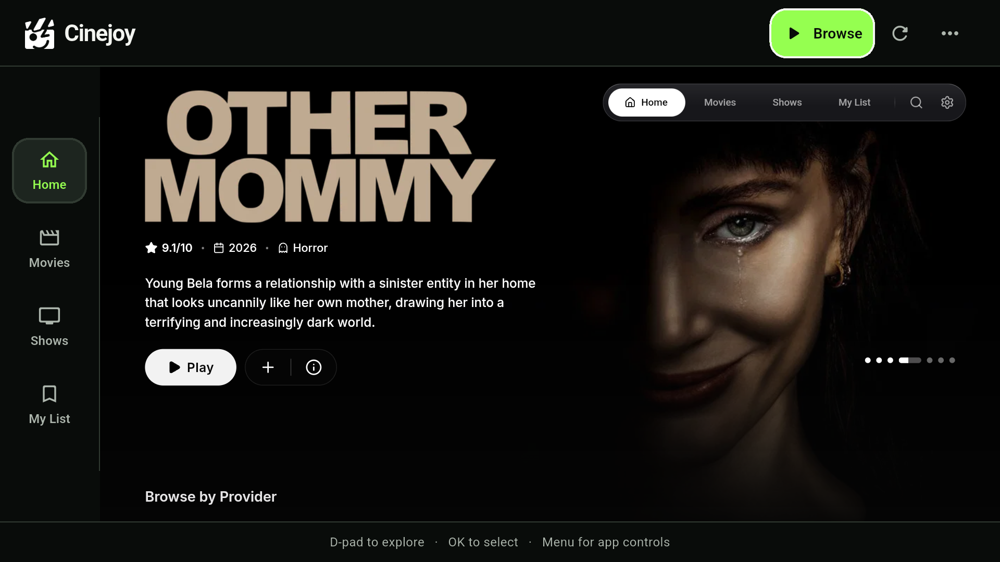
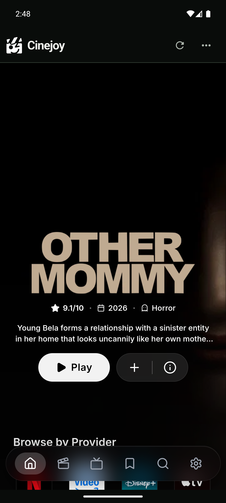

# Cinejoy

Movies and TV shows, on your phone and your big screen.

Cinejoy brings [cinejoy.pk](https://cinejoy.pk/) into a cinematic app for Android
mobile and Android TV. Browse the live catalogue, pick a title, and watch using
Cinejoy's existing player, subtitles, and streaming-source controls.

**[Download the Android APK](https://github.com/Nuelsville/cinejoy-downloads/releases/download/v1.0.0-preview.1/cinejoy-1.0.0-preview.1.apk)** ·
[All downloads](https://github.com/Nuelsville/cinejoy-downloads/releases) ·
[Visit Cinejoy](https://cinejoy.pk/)

The same APK installs on Android phones, tablets, and Android TV. This is a
preview build; iPhone support is available through the Flutter source project.

## What you can do

- Explore movies, shows, and My List from the live Cinejoy website.
- Use touch controls on mobile, or a D-pad and OK button on Android TV.
- Enjoy a dark interface, Cinejoy branding, and clear lime focus highlights.
- Watch with an immersive player and access the website's subtitle and server controls.
- Return through your browsing history, reload a page, and retry after a connection error.
- Pause playback automatically when the app moves into the background.

Cinejoy needs an internet connection. The app uses the live website and its
third-party streaming providers, so catalogue and source availability can vary.

## Screenshots

### Android TV



### Android mobile



## Supported devices

| Platform | Requirements | Installation |
| --- | --- | --- |
| Android phones and tablets | Android 7.0 or newer, with a working Android System WebView | Download the APK below |
| Android TV | Android 7.0 or newer, Android System WebView, and a D-pad remote | Install the same APK; launch from the TV home screen |
| iPhone / iPad | iOS 15 or newer | Build from source with Flutter and Xcode; no IPA download is published |

Some TV firmware does not include Android System WebView. Embedded browsing and
playback require a compatible, up-to-date WebView provider.

## Install on Android mobile

1. [Download Cinejoy](https://github.com/Nuelsville/cinejoy-downloads/releases/download/v1.0.0-preview.1/cinejoy-1.0.0-preview.1.apk) on your phone or tablet.
2. Open the downloaded APK.
3. If Android asks, allow installation from the browser or file manager you used.
4. Tap **Install**, then open **Cinejoy**.
5. Choose a movie or show and use **Play** to open the player.

Only download the APK from the linked Cinejoy releases repository.

## Install on Android TV

1. [Download the same APK](https://github.com/Nuelsville/cinejoy-downloads/releases/download/v1.0.0-preview.1/cinejoy-1.0.0-preview.1.apk) on your computer or phone.
2. Transfer it to your TV using a USB drive or your usual file-transfer method.
3. Open the APK with a TV file manager and allow installation if Android asks.
4. Open **Cinejoy** from the TV's apps screen.
5. Choose **Browse**, or press **Right** from the sidebar, to enter the website's controls.

If the TV is already connected to your computer through ADB, you can install it with:

```sh
adb devices
adb -s <device-id> install -r cinejoy-1.0.0-preview.1.apk
```

Replace `<device-id>` with the TV shown by `adb devices`.

## TV remote controls

| Button | Action |
| --- | --- |
| D-pad | Move the lime focus highlight between titles and controls |
| OK / Select | Open the highlighted title or activate a control |
| Right from the sidebar | Enter the website's catalogue controls |
| Down while Browse is highlighted | Enter the website's catalogue controls |
| Browse | Enter the catalogue or player controls |
| Menu | Return to the app's controls |
| Up or Left beyond the website's controls | Return to the app's controls without a Menu button |
| Play / Pause | Control the current video |
| Rewind / Fast-forward | Seek backward or forward by 10 seconds |
| Back | Close a website dialog, leave fullscreen, return to the previous page, or confirm exit |

Select a search field to open the TV's on-screen keyboard. During playback, the
native app controls are hidden; Menu brings them back.

## If something needs another try

- **The page does not load:** check your internet connection, then select **Reload** or **Try again**.
- **A stream does not start:** use the player's **Servers** control to select another source.
- **The remote appears unresponsive:** close Android TV's system settings or other system panels, then use **Browse**. Look for the lime focus outline.
- **The app cannot display the website:** check that Android System WebView is installed and updated.

## Preview release

Version **1.0.0 Preview 1** is an optimized Android build with development signing.
It retains the starter application identifier `com.example.cinejoy`. It is
intended for sideloading and evaluation; production signing and the final
identifier must be configured before store distribution.

Browsing and playback were checked on Android phone and Android TV emulators.
D-pad focus, reload, history, and pause checks passed on the TV emulator. An
iPhone simulator build also succeeded. Test the intended physical TV before
release because remote behavior, browser providers, and video codecs differ.

## About this repository

This repository contains public APK downloads, screenshots, and installation
instructions. The application source is maintained in a private repository.
